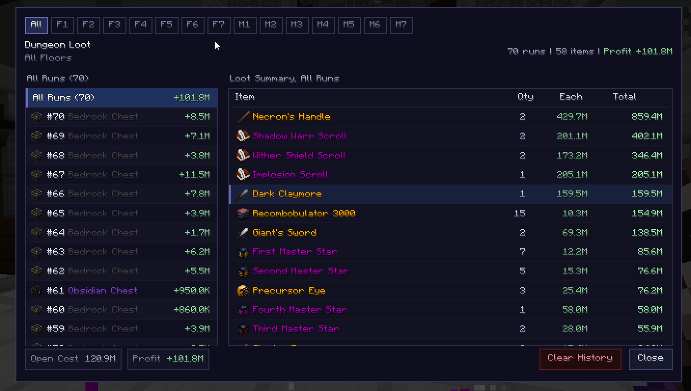

# DungeonRunTracker [DRT]

A Hypixel SkyBlock Fabric mod that tracks Catacombs and Kuudra runs, chest loot, and profit.

**Current stable release:** `1.1.0` (`1.1.0+26.2` / `1.1.0+26.3`)

## Screenshots

## Features

- **Unified DRT window** with Overview, Runs, Loot, Overlay, and Settings tabs
- **Run tracking** for Catacombs floors and Kuudra tiers, including timing and completions
- **Loot logging** for reward chests, with cost, items, profit, and run association
- **Croesus support** for run linking, profit overlay, and reward-chest browsing in the Dungeon Hub
- **Fancy Menu** (optional) replaces reward-chest inventories with DRT's reward panel
- **Live pricing** from the Vyriv price API, with Coflnet as fallback when needed
- **HUD overlays** with presets, custom layouts, scale, visibility modes, and moveable positioning
- **Themes** for the DRT window, with discovery of user-added theme files
- **Statistics Sharing** uploads DRT-captured runs and chests to Vyriv services when enabled
- **First-run setup** covers faction, profit options, Fancy Menu, Croesus overlay, and sharing preferences
- **Bug reports** from chat links via `/drt debug` helpers

## Commands

| Command | Opens |
|---|---|
| `/drt` | Overview |
| `/drt runs` | Runs |
| `/drt loot` | Loot |
| `/drt overlay` | Overlay settings |
| `/drt config` / `/drt settings` | Settings |

When DRT reports a tracking issue in chat, its links use `/drt debug` commands to open or export the bug report.

HUD shortcuts still work while the overlay is visible: click `DRT` to cycle visibility modes, click the floor to cycle floors, and click profit to open Loot.

## Installation

1. Install [Fabric Loader](https://fabricmc.net/use/installer/) for Minecraft **26.2** or **26.3**
2. Install [Fabric API](https://modrinth.com/mod/fabric-api)
3. Drop the matching jar into your `mods/` folder:
   - `DungeonRunTracker-1.1.0+26.2.jar`
   - `DungeonRunTracker-1.1.0+26.3.jar`

### Updating from beta

Beta and stable builds share mod id `drt` and the same `config/drt/` data. Replace the old jar with the matching `1.1.0` jar. Do not keep both a `DRT_BETA-*` jar and a `DungeonRunTracker-*` jar in the same instance.

## Requirements

- Minecraft 26.2 or 26.3
- Fabric Loader 0.19.3+ (26.2) or 0.20.1+ (26.3)
- Fabric API
- Java 25+

## Privacy

Statistics Sharing is on by default for new installs. It uploads DRT-captured run and chest records for the current account. Manual or edited records are not shared. You can turn sharing off in Settings / first-run setup. Privacy details: [vyriv.dev/privacy#drt](https://vyriv.dev/privacy#drt)

## Release notes

See:

- [Public changelog](docs/release/CHANGELOG_1.1.0.md)
- [Technical rewrite report](docs/release/REWRITE_TECHNICAL_REPORT.md)
- [Discord announcement draft](docs/release/DISCORD_RELEASE_1.1.0.md)

## Bug reports

Report issues in Discord with the Minecraft version, DRT jar name, and the `/drt debug` export when DRT posts a tracking report link.
